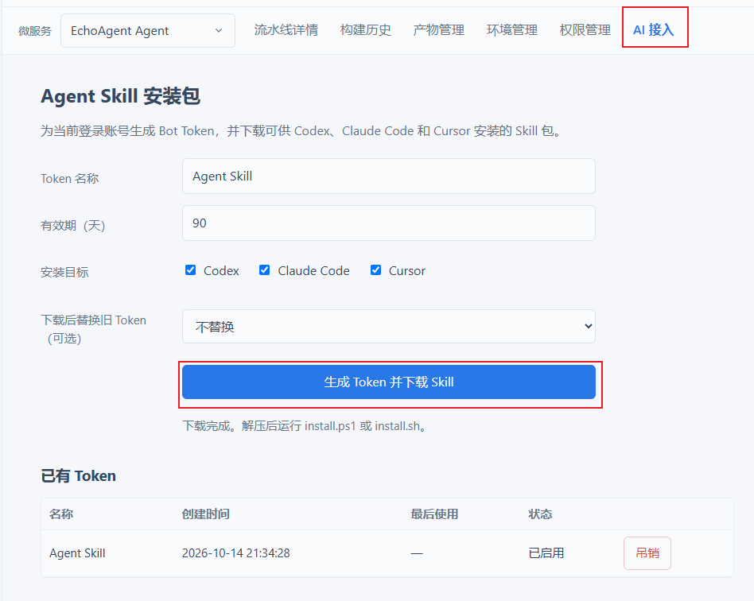
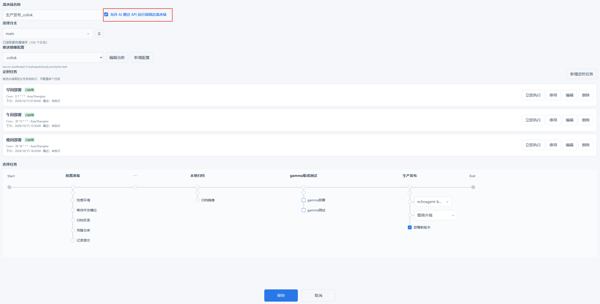
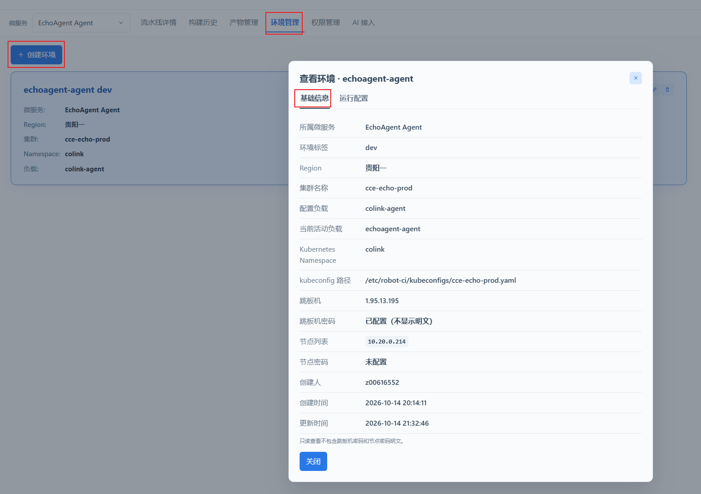
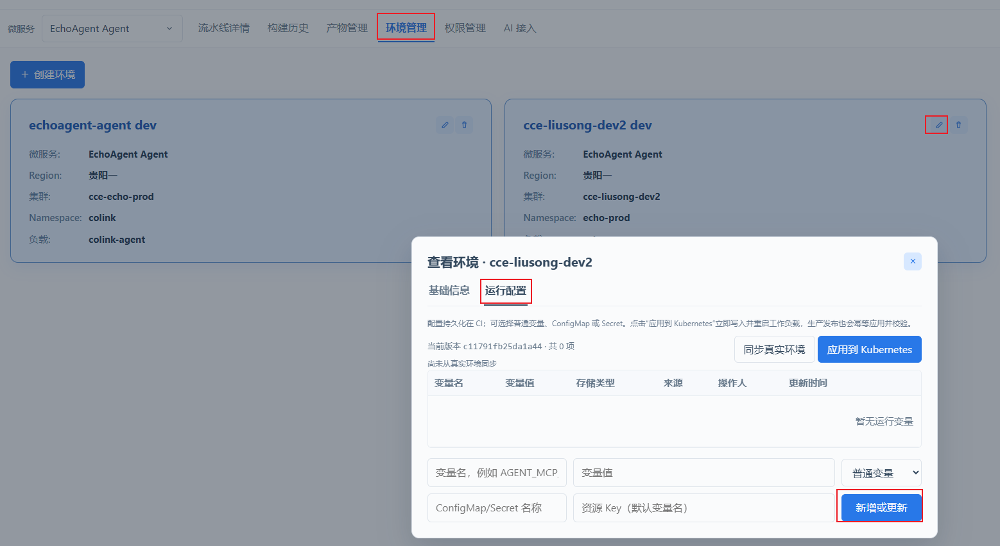
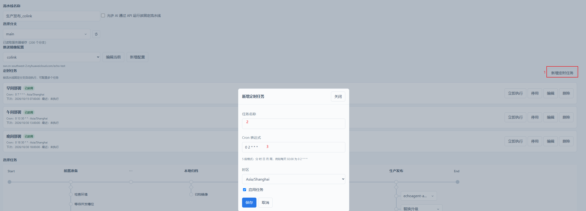
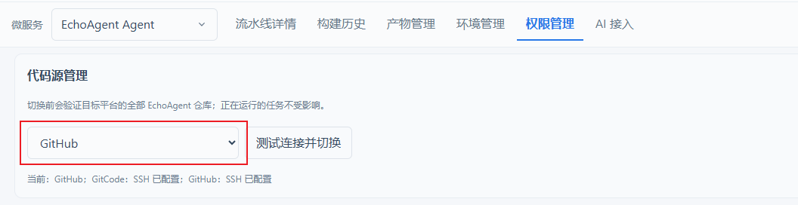

# Robot CI 使用指南

## 1. 访问地址和登录

访问地址：[http://pipline.huawei-colink.com/](http://pipline.huawei-colink.com/)

使用分配给个人工号的账号登录，用户名和密码相同。例如：

```text
用户名：z00111111
密码：z00111111
```

如果系统提示“账号不存在”，或者登录后没有相应的流水线权限，请联系管理员添加账号并分配所需权限。

## 2. 流水线构建

以下两种方式均可执行流水线。对于大多数开发人员，使用已配置好的固定流水线即可。

### 2.1 方式一：使用 AI 部署流水线

#### 2.1.1 下载并安装 Skill 包

登录平台后，进入“AI 接入”页面：



1. 填写 Token 名称。
2. 选择 Token 有效期。
3. 选择需要使用的 Agent：
   - Codex
   - Claude Code
   - Cursor
4. 点击“生成 Token 并下载 Skill”。
5. 解压下载的 ZIP 文件。

Windows 安装全部 Agent：

```powershell
powershell.exe -NoProfile -ExecutionPolicy Bypass -File .\install.ps1 -Agent all
```

也可以只安装到指定 Agent：

```powershell
.\install.ps1 -Agent codex
.\install.ps1 -Agent claude
.\install.ps1 -Agent cursor
```

Linux/macOS：

```bash
sh install.sh --all
```

安装完成后，请重启 Codex、Claude Code 或 Cursor。

> **安全提示：** Skill 包中的配置文件已经包含当前用户的流水线访问 Token，不需要另外配置账号和密码。请勿将 Skill 包或 Token 转发给其他人。

#### 2.1.2 给 Agent 的提示词

部署单个服务：

```text
使用 robot-ci-run-pipeline，把 main 分支最新提交通过 echoagent-backend 的生产发布流水线部署。
```

指定其他分支：

```text
使用 robot-ci-run-pipeline，把 feature/abc 分支最新提交通过 echoagent-frontend 的测试环境流水线部署。
```

同时部署多个服务：

```text
使用 robot-ci-run-pipeline，把 main 分支最新提交通过生产发布流水线部署 backend、frontend 和 router。
```

Agent 会自动完成：

1. 查询当前账号允许调用的固定流水线。
2. 获取远端分支的最新提交 SHA。
3. 调用流水线。
4. 等待流水线执行结束。
5. 返回流水线 Run ID、提交 SHA 和最终结果。

### 2.2 方式二：手动执行固定流水线

1. 登录 Robot CI。
2. 进入“微服务构建”。
3. 选择需要发布的微服务，例如：
   - EchoAgent Backend
   - EchoAgent Frontend
   - EchoAgent Router
4. 在“流水线”下拉框中选择固定流水线，例如：
   - 生产发布
   - 测试环境发布
   - 个人构建流水线
5. 点击“运行”。
6. 选择需要构建的代码分支。
7. 确认执行。

## 3. CI 管理员功能

以下内容面向 CI 管理员，普通开发人员可以跳过。

### 3.1 开放流水线给 AI

只有在流水线编辑页面勾选“允许 AI 通过 API 运行该固定流水线”的流水线，Agent 才能查询和执行。



配置步骤：

1. 进入目标流水线的编辑页面。
2. 勾选“允许 AI 通过 API 运行该固定流水线”。
3. 保存流水线配置。

### 3.2 添加环境

进入对应微服务的“环境管理”页面，点击“创建环境”，填写以下信息：



- 环境名称和环境类型
- Region
- 集群名称
- Kubernetes Namespace
- 工作负载名称
- 跳板机地址及认证信息
- 跳板机上的 kubeconfig 文件路径

填写完成后保存，并检查目标环境的连接和工作负载识别是否正常。

### 3.3 添加 ConfigMap 和 Secret 变量

当新代码增加或调整环境变量时，需要在目标环境中维护对应的运行配置。

1. 进入对应微服务的“环境管理”页面。
2. 找到目标环境并点击“编辑”。
3. 切换到“运行配置”。



4. 填写以下信息：
   - **变量名**：容器内使用的环境变量名。
   - **变量值**：变量对应的值。
   - **存储类型**：普通变量、ConfigMap 或 Secret。
   - **ConfigMap/Secret 名称**：保存变量的 Kubernetes 资源名称。
   - **资源 Key**：不填写时可使用变量名。
5. 点击“新增或更新”，先将配置保存到 CI。
6. 检查全部变量无误后，点击“应用到 Kubernetes”。

> **注意：** 密码、Token、密钥等敏感配置应使用 Secret，避免保存为普通变量或 ConfigMap。

### 3.4 添加流水线定时任务

1. 进入对应微服务的“流水线详情”。
2. 选择需要定时运行的固定流水线。
3. 进入“定时任务”或“参数配置”页面。
4. 点击“新增定时任务”。



5. 配置以下内容：
   - 任务名称
   - 是否启用
   - 执行周期或 Cron 表达式
   - 时区，通常选择 `Asia/Shanghai`
   - 构建分支，例如 `main`
6. 保存后确认任务状态为“已启用”。

### 3.5 GitHub 和 GitCode 源码仓切换

流水线支持在 GitHub 和 GitCode 两套源码仓之间切换。切换后，分支列表、代码拉取和 Commit SHA 校验都会使用当前选择的代码源。



切换步骤：

1. 登录 Robot CI。
2. 打开“源码仓管理”或平台的代码源切换入口。
3. 查看 GitHub 和 GitCode 的连接状态。
4. 选择需要使用的代码源。
5. 点击“切换”并确认。

切换后建议刷新分支列表，并检查目标分支及最新 Commit SHA 是否与所选代码仓一致。
